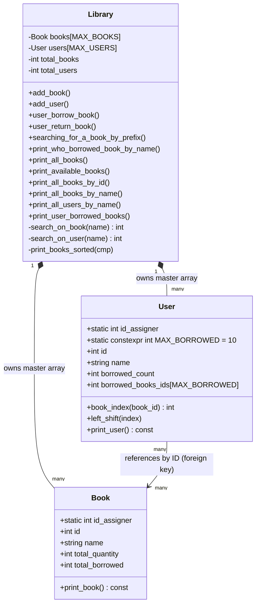

# Library System (Project #2)

A console-based **library management system** written in modern C++ (C++20). An admin can register books and users, lend and return copies, search the catalog by prefix, and print sorted reports in formatted tables. Every operation keeps the book inventory and each user's borrowed list in sync.

> Course project from **Mostafa S. Ibrahim's** C++ course (Section 15). The original specification is summarized in [Appendix: Course Specification](#appendix-course-specification). The problems I ran into and what I learned from them are in [mistakes.md](mistakes.md).

---

## Table of Contents

- [Quick Start](#quick-start)
- [Features](#features)
- [Architecture](#architecture)
- [Key Design Decisions](#key-design-decisions)
- [Validation and Error Handling](#validation-and-error-handling)
- [Time Complexity](#time-complexity)
- [Example Session](#example-session)
- [Differences From the Course Specification](#differences-from-the-course-specification)
- [Limitations and Possible Improvements](#limitations-and-possible-improvements)
- [Lessons Learned](#lessons-learned)
- [Appendix: Course Specification](#appendix-course-specification)

---

## Quick Start

### Requirements

- A compiler with **C++20** support. The code uses `std::format`, so you need GCC 13+, Clang 17+, or MSVC 19.29+ (Visual Studio 2019 16.10+).
- Standard library only. No external dependencies.

### Build and Run


**GCC / Clang**

```bash
g++ -std=c++20 -Wall -Wextra -O2 library.cpp -o library
./library
```

**MSVC (Developer Command Prompt)**

```bat
cl /std:c++20 /EHsc /W4 library.cpp /Fe:library.exe
library.exe
```

---

## Features

After each action, the program prints the menu again. It keeps running until you choose **13 (Exit)**.

| # | Action | What it does | Changes state? |
| :-: | :--- | :--- | :-: |
| 1 | `add_book` | Adds a new title with a quantity. The ID is generated automatically. Duplicate names are rejected. | ✅ |
| 2 | `add_user` | Registers a user. The ID is generated automatically. Duplicate names are rejected. | ✅ |
| 3 | `user_borrow_book` | Lends one copy to a user if a copy is available, the user doesn't already have this title, and the user hasn't hit the borrow limit. | ✅ |
| 4 | `user_return_book` | Takes a copy back and removes it from the user's list. | ✅ |
| 5 | `search_books_by_prefix` | Lists every book whose name **starts with** the given text. | ❌ |
| 6 | `print_who_borrowed_book_by_name` | Lists every user who currently has the given book. | ❌ |
| 7 | `print_all_books` | Prints all books and the library totals (available, borrowed, and total copies). | ❌ |
| 8 | `print_available_books` | Prints only books that have at least one free copy. | ❌ |
| 9 | `print_library_by_id` | Prints the catalog sorted by ID. | ❌ |
| 10 | `print_library_by_name` | Prints the catalog sorted alphabetically. | ❌ |
| 11 | `print_users` | Prints users sorted by name, with the books each one has borrowed. | ❌ |
| 12 | `print_user_borrowed_books` | Prints the books borrowed by one user. | ❌ |
| 13 | `Exit` | Ends the program. | — |

Options **7, 8, and 12** come from the "optional extensions" in the course specification.

---

## Architecture

The program has three types plus a small `ui` helper namespace:



| Component | Responsibility |
| :--- | :--- |
| `ui` namespace | Reads input with `read_line` and `read_int`, prints status messages (`[OK]`, `[i]`, `[!]`), and builds table borders. |
| `Book` | One title: its ID, name, available copies (`total_quantity`), and borrowed copies (`total_borrowed`). |
| `User` | One user and a fixed-size list of the book IDs they've borrowed (up to 10). |
| `Library` | Owns the master arrays and implements every menu action. |
| `main` | Runs the menu loop and turns any exception into an error message. |

---

## Key Design Decisions

### 1. Auto-increment IDs, like a database

Both `Book` and `User` keep an `inline static int id_assigner`. The constructor that takes arguments claims the next ID. The empty default constructor doesn't, so filling the 10,000-slot arrays at startup uses up no IDs.

### 2. ID = array index, so lookup by ID is O(1)

IDs start at `0` and go up by one, and records are never deleted. That means `books[id]` and `users[id]` always point at the right record. Borrowing stores only the **book ID** in the user's list (a "foreign key"), and the program goes straight to `books[id]` when it needs the book.

### 3. Sort a copy, never the master array

Sorting `books[]` in place would move records to new positions, and `books[id]` would then point at the wrong book. So `print_books_sorted` makes a temporary copy on the heap, sorts and prints the copy, and then frees it. The master data stays in place. Both comparators are `static` functions, so they can be passed to `std::sort`.

### 4. Loops stop at the number of records, not the array size

Every search loops up to `total_books`, `total_users`, or `borrowed_count`, never up to `MAX_*`. This keeps searches at O(n) and makes sure no loop reads an empty or uninitialized slot.

### 5. Read input one line at a time

All input goes through `ui::read_line`, which uses `getline`. This avoids the common bug where `cin >>` leaves a newline behind. `read_int` only accepts input that is a complete integer, so `12abc` is rejected.

### 6. The `Library` object lives on the heap

The two arrays add up to about 1.4 MB, which can overflow the default stack (1 MB on Windows). `main` creates the library with `std::make_unique<Library>()` instead.

### 7. Errors are exceptions, caught in one place

Invalid input throws `std::invalid_argument`. `main` catches it, prints `[!] <message>`, and shows the menu again. Expected business-rule refusals, such as "no copies available", print a message and return without throwing. If stdin closes, the loop stops instead of running forever.

---

## Validation and Error Handling

| Situation | Response |
| :--- | :--- |
| Non-numeric menu choice or quantity | `Please enter a valid number.` (asks again) |
| Menu choice outside 1–13 | `Invalid option, choose 1-13.` |
| Empty book or user name | Rejected |
| Duplicate book or user name | Rejected |
| Quantity ≤ 0 | `Quantity must be at least 1.` |
| Unknown user or book | `There is no user named '...'!` / `'...' doesn't exist in the library!` |
| No copies available | `No copies of '...' are available right now.` |
| User already has this title | `<user> already has '...'.` |
| User has 10 borrowed books | `<user> has reached the maximum of 10 borrowed books.` |
| Returning a book the user doesn't have | `<user> didn't borrow '...'.` |
| Library full (10,000 books or users) | Rejected |

---

## Time Complexity

Let **B** = number of books, **U** = number of users, **K** = books borrowed by one user (at most 10).

| Operation | Complexity | Why |
| :--- | :--- | :--- |
| Add book / user | O(B) / O(U) | Checks for a duplicate name first |
| Borrow / return | O(B + U + K) | Finds the user and book by name, then O(1) access by ID |
| Search by prefix | O(B · P) | Checks only the first P characters of each name (P = prefix length) |
| Who borrowed a book | O(B + U · K) | |
| Print all / available | O(B) | |
| Print sorted by ID / name | O(B log B) | Copy plus `std::sort` |
| Print users | O(U log U + U · K) | |

---

## Example Session

This sample session follows the code exactly. The menu is shown once and left out after that.

```text
+-----+---------------------------------------------+
|                   Library Menu                    |
+-----+---------------------------------------------+
| No. | Action Description                          |
+-----+---------------------------------------------+
|   1 | add_book                                    |
|   2 | add_user                                    |
|   3 | user_borrow_book                            |
|   4 | user_return_book                            |
|   5 | search_books_by_prefix                      |
|   6 | print_who_borrowed_book_by_name             |
|   7 | print_all_books                             |
|   8 | print_available_books                       |
|   9 | print_library_by_id                         |
|  10 | print_library_by_name                       |
|  11 | print_users                                 |
|  12 | print_user_borrowed_books                   |
|  13 | Exit                                        |
+-----+---------------------------------------------+
Choose an option (1-13): 1
Book name: CppHowToProgram
Quantity: 3
[OK] Added 'CppHowToProgram' (id 0, 3 copies).

Choose an option (1-13): 1        # also added: CppForDummies (2), CoreJava (1)
...
Choose an option (1-13): 2
User name: mostafa
[OK] Added user 'mostafa' (id 0).  # also added: ali (id 1)

Choose an option (1-13): 3
User name: mostafa
Book name: CppHowToProgram
[OK] mostafa borrowed 'CppHowToProgram'.

Choose an option (1-13): 3
User name: ali
Book name: CoreJava
[OK] ali borrowed 'CoreJava'.

Choose an option (1-13): 3
User name: mostafa
Book name: CoreJava
[!]  No copies of 'CoreJava' are available right now.

Choose an option (1-13): 5
Prefix: Cpp
Books starting with 'Cpp':
  1. CppHowToProgram (id 0)
  2. CppForDummies (id 1)

Choose an option (1-13): 10
+------+--------------------------------+-----------+----------+
| ID   | Name                           | Available | Borrowed |
+------+--------------------------------+-----------+----------+
| 2    | CoreJava                       |         0 |        1 |
| 1    | CppForDummies                  |         2 |        0 |
| 0    | CppHowToProgram                |         2 |        1 |
+------+--------------------------------+-----------+----------+
3 book(s)

Choose an option (1-13): 11
+------+---------------------------+----------+
| ID   | Name                      | Borrowed |
+------+---------------------------+----------+
| 1    | ali                       |     1/10 |
|      -> CoreJava (id 2)
| 0    | mostafa                   |     1/10 |
|      -> CppHowToProgram (id 0)
+------+---------------------------+----------+
2 user(s)

Choose an option (1-13): 4
User name: ali
Book name: CppForDummies
[!]  ali didn't borrow 'CppForDummies'.

Choose an option (1-13): 13
Goodbye!
```

---

## Differences From the Course Specification

| Topic | Course spec / demo | My implementation | Reason |
| :--- | :--- | :--- | :--- |
| Book / user IDs | Typed in by the admin (the demo even allows duplicates) | Generated automatically (`0, 1, 2, …`) | Unique IDs, and IDs double as array indexes for O(1) access |
| Book input | `id name quantity` on one line | Name and quantity on separate prompts | Line-based input; IDs are automatic |
| `total_quantity` | Total copies; never changes | **Available** copies; goes down on borrow and up on return | Total = `total_quantity + total_borrowed` (shown in option 7) |
| Duplicate titles | Not checked | Rejected | Book names are used as lookup keys |
| Menu | 10 options | 13 options | Adds `print_all_books`, `print_available_books`, `print_user_borrowed_books` |
| `print_users` | Users in insertion order, borrowed IDs sorted | Users sorted by name, borrowed books listed by name and ID | More readable |
| Borrow rules | Only checks that copies are available | Also blocks borrowing the same title twice, and limits each user to 10 books | Keeps records consistent |
| Output format | Plain `id = … name = …` lines | Tables built with `std::format` | Readability |
| Names with spaces | Not allowed | Allowed (`getline`) | Flexibility |

---

## Limitations and Possible Improvements

- **Memory only.** Everything is lost when the program exits. *Improvement:* save to and load from a file.
- **Fixed capacity.** 10,000 books, 10,000 users, and 10 borrowed books per user. *Improvement:* `std::vector`, which also removes the 1.4 MB fixed allocation.
- **Linear name lookups.** *Improvement:* `std::unordered_map<string, int>` from name to ID for O(1) lookup.
- **Manual `new[]` / `delete[]`** for the sorted copies. *Improvement:* `std::vector<Book>` or `std::unique_ptr<Book[]>` (RAII), so memory is freed even if an exception is thrown.
- **`borrowed_books_ids` is never initialized.** The `borrowed_count` limit keeps this safe, but `int borrowed_books_ids[MAX_BORROWED] = {};` makes it explicit.
- **No deletion.** Records are never removed, which keeps `id == index` true. Supporting deletion would need a map from ID to index, or a "deleted" flag.
- **Case-sensitive** names and prefix search.
- **Possible extra features:** sort users by ID, a due date for each loan, and an `email`/`address` for each user.

---

## Lessons Learned

Every bug, review comment, and "why doesn't this compile?" moment from this project is written up in **[mistakes.md](mistakes.md)**. Topics include static auto-increment IDs, const correctness, comparators for `std::sort`, the difference between an ID and an index, foreign-key integrity when sorting, and stack vs. heap memory.

---

## Appendix: Course Specification

<details>
<summary><strong>Click to expand the original Project #2 specification (from <em>01 Project #2 Description.pdf</em> and <em>02 Project #2 Demo.pdf</em>)</strong></summary>

### A.1 Scope and Control Loop

The system is used by a single **admin**. There is **no login or logout**. The program shows the main menu, runs the chosen operation, and repeats until **Exit**.

```text
Library Menu;
1) add_book
2) search_books_by_prefix
3) print_who_borrowed_book_by_name
4) print_library_by_id
5) print_library_by_name
6) add_user
7) user_borrow_book
8) user_return_book
9) print_users
10) Exit

Enter your menu choice [1 - 10]: 
```

| Choice | Command | Inputs | State change |
| :--- | :--- | :--- | :--- |
| 1 | `add_book` | ID, name, total quantity | Adds a book |
| 2 | `search_books_by_prefix` | Name prefix | Read-only |
| 3 | `print_who_borrowed_book_by_name` | Book name | Read-only |
| 4 | `print_library_by_id` | — | Read-only |
| 5 | `print_library_by_name` | — | Read-only |
| 6 | `add_user` | Name, national ID | Adds a user |
| 7 | `user_borrow_book` | User name, book name | Borrow + counts |
| 8 | `user_return_book` | User name, book name | Return + counts |
| 9 | `print_users` | — | Read-only |
| 10 | `Exit` | — | Ends the program |

### A.2 Entities

- **Book:** integer `id`, a `name` with **no spaces** (for example, `CppHowToProgram`), and `quantity` (for example, `101, CppHowToProgram, 7`).
  - The *description* decreases `quantity` when a book is borrowed. The *demo* keeps `total_quantity` the same and tracks `total_borrowed` separately (available = `total_quantity - total_borrowed`).
  - In the demo, `prog1` and `prog2` share ID `201`, so unique IDs are not enforced.
- **User:** `name` and an integer ID (a national ID in the demo, for example `mostafa 30301`). Many users can borrow copies of the same book.

### A.3 Book Operations (Choices 1–5)

**Add book**

```text
Enter book info: id & name & total quantity: 100 math4 3
```

**Search by prefix.** Prints the matches in insertion order. Spec test case: with `CppHowToProgram`, `CppForDummies`, `CppForAdvancedLevels`, and `CoreJava` in the library, `Cpp` returns 3 titles, `CppFo` returns 2, `Core` returns 1, and `Java` returns none.

```text
Enter book name prefix: ma
math4
math2
math1
math3
Enter book name prefix: machine
No books with such prefix
```

**Who borrowed a book**

```text
Enter book name: math1
mostafa
ali
noha
Enter book name: machine
Invalid book name.
```

**Print by ID / by name.** Format: `id = <id> name = <name> total_quantity <q> total_borrowed <b>`. Books with the same ID keep the order they were entered in. Spec example: books `(1111, Math1)`, `(5041, ArabicLiterature)`, `(1011, Math2)` → by name: `ArabicLiterature, Math1, Math2`; by ID: `Math2, Math1, ArabicLiterature`.

```text
id = 102 name = math1 total_quantity 4 total_borrowed 0
id = 101 name = math2 total_quantity 5 total_borrowed 0
id = 103 name = math3 total_quantity 2 total_borrowed 0
id = 100 name = math4 total_quantity 3 total_borrowed 0
id = 201 name = prog1 total_quantity 5 total_borrowed 0
id = 201 name = prog2 total_quantity 3 total_borrowed 0
```

### A.4 User and Borrowing Operations (Choices 6–9)

```text
Enter user name & national id: mostafa 30301
Enter user name and book name: mostafa math1      (borrow / return)
```

- **Borrow:** only allowed when a copy is available (`quantity > 0`). Otherwise, tell the admin.
- **Return:** restores availability and removes the book from the user's list.
- **Print users:** borrowed IDs appear in ascending order, not in the order they were borrowed:

```text
user mostafa id 30301 borrowed books ids: 101 102 103
user ali id 50501 borrowed books ids: 101 102
user noha id 70701 borrowed books ids: 101 102
user ashraf id 90901 borrowed books ids:
```

### A.5 Reference Demo Trace

1. Add `100 math4 3`, `101 math2 5`, `102 math1 4`, `103 math3 2`, `201 prog1 5`, `201 prog2 3`, then print by ID and by name.
2. Add users `mostafa 30301`, `ali 50501`, `noha 70701`, `ashraf 90901`.
3. Borrows: `mostafa` borrows math1, math2, and math3. `ali` and `noha` each borrow math1 and math2.
4. Check prefixes (`ma`, `pro`, `machine`) and borrowers (`math1`, `math2`, `machine`).
5. Return `mostafa math1`, then check the final state:

```text
id = 100 name = math4 total_quantity 3 total_borrowed 0
id = 101 name = math2 total_quantity 5 total_borrowed 3
id = 102 name = math1 total_quantity 4 total_borrowed 2
id = 103 name = math3 total_quantity 2 total_borrowed 1
id = 201 name = prog1 total_quantity 5 total_borrowed 0
id = 201 name = prog2 total_quantity 3 total_borrowed 0

user mostafa id 30301 borrowed books ids: 101 103
user ali id 50501 borrowed books ids: 101 102
user noha id 70701 borrowed books ids: 101 102
user ashraf id 90901 borrowed books ids:
```

### A.6 Optional Extensions and Open Choices

Suggested extensions: sort users by name or ID, list the borrowed books of one user, store extra user details (`email`, `address`), and generate IDs automatically.

Left to the developer: C++ version, data structures, capacity limits, saving data, and the wording of error messages for edge cases. The one rule is: **tell the admin and keep the data consistent.**

</details>
